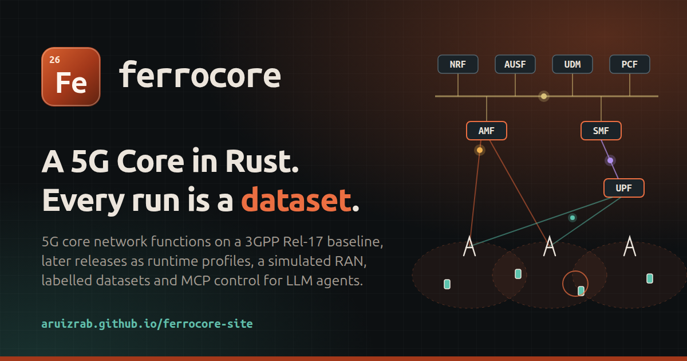

# ferrocore-site 

> A 5G Core in Rust. Every run is a dataset.

[](https://github.com/aruizrab/ferrocore-site/actions/workflows/pages.yml)
[](LICENSE)
[](#local-preview)

**The landing page for ferrocore, a 5G Core written in Rust for R&D and ML / LLM-agent training, with a 3GPP Release 17 baseline and later releases as runtime release profiles.** It explains what ferrocore is, its architecture and how it is built, and shows live build progress read from `progress.json`.

Live at **https://aruizrab.github.io/ferrocore-site/**



## What is in this repo

| Path | Purpose |
| --- | --- |
| `index.html` | The whole page: hero, what it is, capabilities, architecture, process, roadmap, progress |
| `css/style.css` | Styles and the colour tokens (light and dark) |
| `js/hero.js` | Animated 5G core in the hero (canvas, honours `prefers-reduced-motion`) |
| `js/progress.js` | Fetches and renders `progress.json` |
| `js/main.js`, `js/theme-init.js` | Theme toggle and mobile navigation |
| `assets/` | Favicon, social card (`og.svg` is the source of `og.png`) |
| `assets/fonts/` | Self-hosted Ubuntu Sans (Ubuntu Font Licence 1.0) and JetBrains Mono (SIL OFL 1.1) Latin subsets, with their licences |
| `progress.json` | Progress data shown on the page |
| `.github/workflows/pages.yml` | Deploys the repository root to GitHub Pages |
| `.github/scripts/check_site.py` | Pre-deploy checks: `progress.json` schema, local links, no e-mail addresses, private-repository links or absolute filesystem paths |

No build step, no npm, no third-party requests: the fonts are served from `assets/fonts/`. All URLs are relative, so the page works under `/ferrocore-site/` (or any other repo name). The only absolute URLs are the canonical and Open Graph tags in `index.html`, which must name the published address.

## Local preview

```bash
python3 -m http.server 8000
# open http://localhost:8000/
```

Open the page through the server, not as a `file://` URL: the progress section fetches `progress.json`, which browsers block on `file://`.

Run the same checks CI runs before deploying:

```bash
python3 .github/scripts/check_site.py
```

## How `progress.json` is updated

The file holds real data published by ferrocore's CI. The schema keeps a `"placeholder"` flag: when it is `true` (as in the very first version of the file, before CI published), the page shows a "Placeholder data" banner.

ferrocore's CI computes progress with an interim (v0) script on pushes to its `main` and `feat/**` branches and on a schedule, and commits the result here as `progress.json`, authenticated with a deploy key that has write access to this repository (the private half is stored in ferrocore as the `SITE_DEPLOY_KEY` secret). It commits only when the numbers change, not when only `generatedAt` or `commit` would. That push to `main` triggers the Pages workflow, which redeploys the site. The official metric (ferrocore feature F051) will replace the v0 script later and keep this schema.

The v0 script derives a stage per roadmap feature from the feature's spec, plan, tasks and branch state, and weights it: merged 100, implemented 95 (spec marked implemented, branch not merged yet), implementing 30 to 90 by the share of tasks done, tests 30 (failing tests committed), planned 20, spec approved 15, spec draft 5, not started 0. Milestone and overall percentages are unweighted means of their features. Features that belong to no milestone (the roadmap's cross-cutting development quality gates) form their own group, which counts in the overall figure only.

Schema version 1:

```json
{
  "schema": 1,
  "placeholder": false,
  "generatedAt": "2026-11-11T12:00:00Z",
  "commit": "abc1234",
  "method": "one line describing how the numbers are computed",
  "overall": 42.5,
  "milestones": [
    { "id": "M0", "name": "Foundations", "kind": "milestone", "percent": 80, "features": 10 },
    { "id": "CC", "name": "Development quality gates", "kind": "cross-cutting", "percent": 0, "features": 2 }
  ],
  "features": [{ "id": "F001", "name": "Workspace foundations", "milestone": "M0", "stage": "merged", "percent": 100 }]
}
```

`stage` is one of `merged`, `implemented`, `implementing`, `tests`, `planned`, `spec-approved`, `spec-draft`, `not-started`. `milestones[].features` is the number of features in the milestone (the page also accepts a list of feature ids). `milestones[].kind` is optional: `milestone` (the default) or `cross-cutting`, a group outside every milestone that features reference through their `milestone` field and the page lists separately. A trailing note such as `(placeholder, specs later)` is dropped from names on display. The hero status chip and the roadmap's "Now" marker show the first milestone below 100 %. Percentages are 0 to 100. An all-zero `commit` is treated as "no commit" and not shown. If the file is missing or invalid the page says so and keeps the rest of the content.

## Deployment

`.github/workflows/pages.yml` runs on every push to `main` and on manual dispatch. It checks the site, then uploads the repository root with `actions/upload-pages-artifact` and publishes it with `actions/deploy-pages`. Deployments share the `pages` concurrency group without cancelling: a deployment in flight completes and the newer run waits for it.

In the repository settings, **Pages > Build and deployment > Source** must be set to **GitHub Actions**.

## Publishing rules

This page is public; ferrocore's source is not yet. Keep it that way: no 3GPP specification text, no keys or secrets, no e-mail addresses, no links to private repositories and no internal file paths. The pre-deploy check catches e-mail addresses, links to the private ferrocore repository, absolute filesystem paths and broken local links; the rest is on review.

## Licence

MIT, see [LICENSE](LICENSE). ferrocore itself is dual-licensed Apache-2.0 OR MIT. The fonts in `assets/fonts/` keep their own licences: Ubuntu Sans under the [Ubuntu Font Licence 1.0](assets/fonts/UBUNTU-FONT-LICENCE.txt) (Canonical's upstream Latin webfont subset, unmodified) and JetBrains Mono under the [SIL Open Font License 1.1](assets/fonts/JETBRAINS-MONO-OFL.txt).
